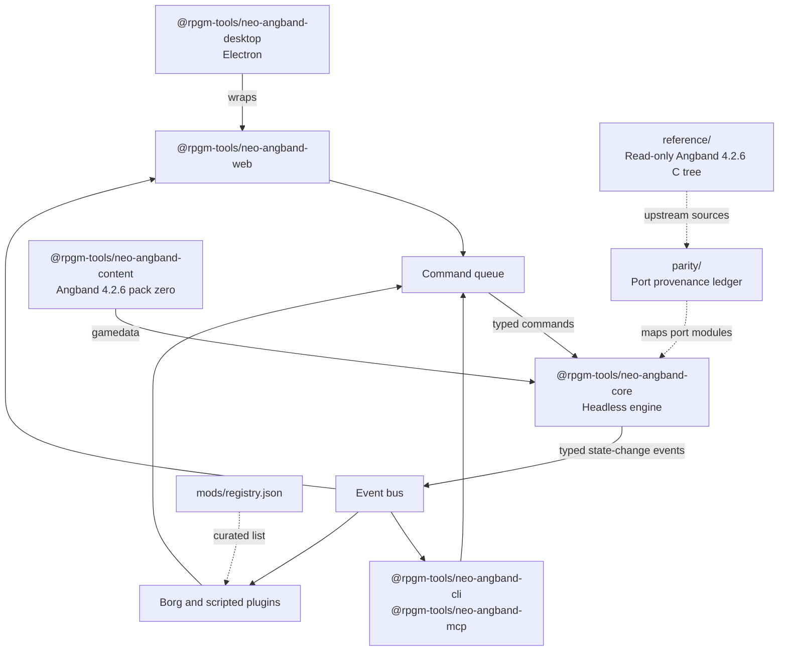
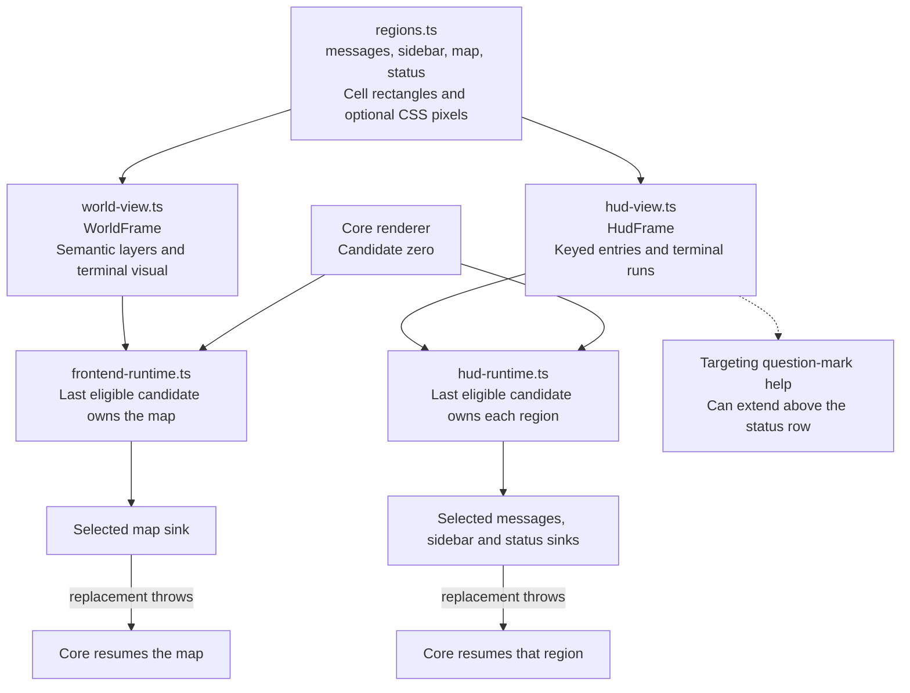
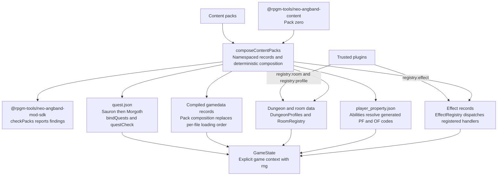
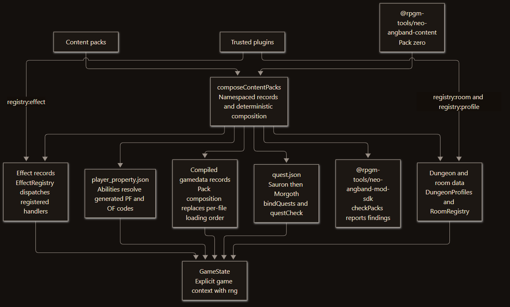
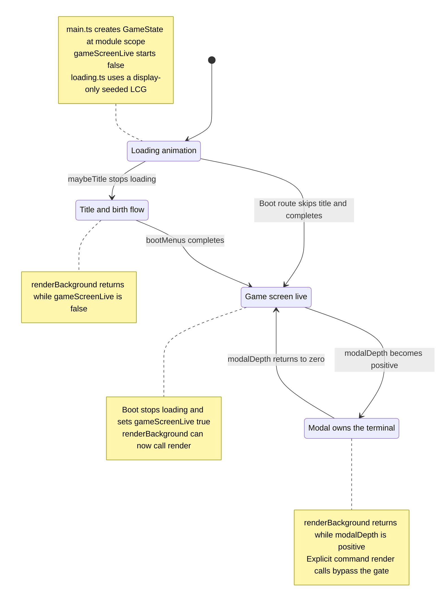

# Architecture

## Monorepo layout

| Package | Role |
| --- | --- |
| `@rpgm-tools/neo-angband-core` | Headless engine: rules, world, entities, effects, generation, saves. Runs anywhere (browser, Node, workers). |
| `@rpgm-tools/neo-angband-content` | The core content pack: Angband 4.2.6 gamedata compiled into pack format. Pack zero. |
| `@rpgm-tools/neo-angband-mod-sdk` | Pack schemas, validation, and tooling for the mod ecosystem. |
| `@rpgm-tools/neo-angband-web` | Web + PWA front-end (v1 target): modern glyph-first renderer. |
| `@rpgm-tools/neo-angband-cli` | Terminal front-end and dev harness (golden scenarios, stats runs). |
| `@rpgm-tools/neo-angband-desktop` | Optional Electron desktop wrapper around the same web bundle. |
| `@rpgm-tools/neo-angband-linoleum` | Linoleum loose-pack tile format: the converter (Node) plus the format readers and portable md5 the web renderer uses. |
| `@rpgm-tools/neo-angband-mcp` | Model Context Protocol server: plays the game through the frozen agent API. See [MCP.md](./MCP.md). |
| `reference/` | The original C tree at parity baseline 4.2.6, buildable, read-only. |
| `parity/` | Machine-readable provenance ledger mapping port modules to upstream sources. |

## The two seams (inherited from upstream, kept on purpose)

*Source of truth: `docs/ARCHITECTURE.md` and `pnpm-workspace.yaml`. `mods/registry.json` lists the Borg repository, and the engine holds no UI references.*

Upstream Angband's core/UI boundary is unusually clean, built on two
mechanisms this port preserves as its public API:

- **Command queue** (upstream `src/cmd-core.c`): front-ends push typed
  commands; the engine consumes them. Nothing else gets input into the game.
- **Event bus** (upstream `src/game-event.c`): the engine publishes typed
  state-change events; front-ends subscribe. The engine holds no UI
  references.

Everything that talks to the engine - the web UI, the CLI, the Borg autoplayer,
the MCP server, scripted plugins - speaks through these two seams.

## The screen, by name

*Source of truth: `packages/web/src/regions.ts`, `world-view.ts`, and `hud-view.ts`. Targeting help is the one documented exception in `docs/ARCHITECTURE.md`.*

Upstream's two seams get data OUT of the engine. They say nothing about how it
is arranged, and for most of the port's life the arrangement was private: the
map, the vitals, the message line and the status line were drawn by closures in
`main.ts`, so "where is the map" and "what are the player's hit points" had no
answer that anything outside could ask. Three modules now answer, in the same shape:

- `regions.ts` names the parts of the screen - `messages`, `sidebar`, `map`,
  `status` - and publishes each one's rectangle in grid cells AND CSS pixels.
  **The names are roles, not places:** `sidebar` is "the vitals", which is a
  13-column column in one layout, a one-line header in another, and absent in a
  third.
- `world-view.ts` describes what is IN the map: a `WorldFrame` of cells carrying
  both their semantic layers and the terminal's resolved glyph, handed to a sink
  the selected front end owns (`frontend-runtime.ts`).
- `hud-view.ts` does the same for everything around it: a `HudFrame` of named
  sections, each a list of keyed entries (`hp`, `depth`, `state`) whose runs
  carry the engine's `COLOUR_*` attribute beside the css the terminal resolves.

The pattern is the same in all three, and it is worth stating once: **each
publishes the semantic answer and the faithful terminal's projection of it side
by side.** A replacement reads the first and ignores the second; the glyph grid
reads the second and ignores the first. Neither has to reverse-engineer the
other, which is what makes a tile, isometric or sprite renderer possible without
core losing the exact 4.2.6 screen.

A section also carries the region it plays the role of, which is what makes "core
draws its furniture inside the rectangles core publishes" a test rather than a
convention. The one deliberate exception is the '?' help overlay of the targeting
loop, which takes as many rows as it needs above the status row - upstream's
behaviour, and a fact a replacement needs told rather than hidden.

Each frame has an OWNER, and the two seams differ in how many. `frontend-runtime.ts`
selects one owner for the map; `hud-runtime.ts` selects one **per region**, so a
mod can take the vitals and leave the message line with the game. Both work the
same way otherwise - core's own renderer is candidate zero in the same list under
the same last-in-load-order rule, so the seam demonstrably expresses the display
the game already ships, and a replacement that faults hands its work back to core
mid-session. The HUD's recovery is per region for the same reason its grant is:
losing your hit points because the mod drawing the status line threw would be a
bigger blast radius than the grant.

## What changes from upstream (the five chokepoints)

*Source of truth: `packages/mod-sdk/src/loader.ts`, `packages/core/src/effects/interpreter.ts`, and `packages/content/pack/quest.json`.*

The C original locks behavior behind compiled code. The port dissolves each
chokepoint into data:

1. **Effects** (upstream: ~250 fixed opcodes in `list-effects.h` with C
   handlers): a schema-validated declarative effect language interpreted by
   the engine. Content packs compose conditions, triggers, and outcomes as
   data. The sandboxed script layer covers what declaration cannot.
2. **Player ability flags** (upstream: closed `PF_*` enum with scattered
   checks): abilities become registry-defined behaviors packs can add to.
3. **Name-bound generators** (upstream: `list-dun-profiles.h`, `list-rooms.h`
   binding data names to C functions): generation algorithms register in an
   extensible registry; profiles, room builders, and their parameters are
   pack content.
4. **The parser** (upstream: bespoke per-file grammars writing into fixed C
   structs, hand-ordered load): a schema-driven pack loader with namespaced
   IDs, explicit dependencies, and deterministic merge semantics.
5. **Quests and the win condition** (upstream: hardcoded kill-quest
   semantics in `player-quest.c`): a data-driven objective/trigger system;
   the classic Sauron-then-Morgoth spine is simply the core pack's content.

## Boot: nothing paints the map until there is a game

*Source of truth: `packages/web/src/main.ts` and `loading.ts`. Targeting, locate, and level-map renders bypass the boot gate on purpose.*

`packages/web/src/main.ts` builds a real game at module scope. It has to, because
every screen below the title reads from a live `GameState`. That made one thing
very easy to get wrong, and the port got it wrong for months: the shell painted
that game's map immediately, so the player watched a generated town belonging to
a character they had not chosen while boot finished its work behind it. Measured
on the shipped Windows build (2026-08-13) the town was on screen from 6.9s to
12.7s after launch.

Two rules keep it fixed, and both are asserted by tests that read `main.ts` as
text (it cannot be imported, because importing it boots a game):

- **`gameScreenLive`** gates `renderBackground()` alongside `modalDepth`. It is
  false until the boot chain settles on a game. The two gates answer different
  questions and neither substitutes for the other: `modalDepth` is *is something
  else using the terminal right now*, `gameScreenLive` is *is there a game to
  draw at all*. An earlier attempt painted the title art first and still lost,
  because a `ResizeObserver` settle came back through `renderBackground` with
  `modalDepth` at 0 and put the map straight back.
- **The loading screen owns the gap** (`packages/web/src/loading.ts`): a dungeon
  carving itself out, everything except the paint being pure functions over a
  seeded LCG so it can be tested without a clock or a canvas. It never draws from
  the game's RNG: it runs before a character exists, and a draw there would move
  a stream position saves re-derive the world from. The `@` is **not** the
  digger: the digger is generation and is never drawn, while the `@` moves only
  onto carved floor and plays a little: wanderers give chase, it fights or
  flees, and it cannot die (there is no character to kill yet, so it escapes at
  zero instead). Both turns are exported so tests can drive them with the map
  frozen, which is the only way to tell a walker from a digger: the digger
  carves the square it steps onto, so "standing on floor" is true of both.

Deliberate in-command `render()` calls (targeting, locate, the level map) are
untouched by all of this; only *background* repaints go through the gate.

## Engine principles

- No globals. Upstream's `player`/`cave`/`world` singletons become an
  instantiable game context. Multi-instance by construction.
- Deterministic, named RNG streams. Upstream uses one global stream with
  a seed-swap trick for flavors and randarts. The port gives each system a
  named seeded stream (generation, gameplay, flavors, randarts, ...) so
  content is reproducible and saves can serialize exact RNG state.
- Registries everywhere. All content - monsters, items, effects,
  generators, objectives - lives in namespaced registries populated by
  packs. The engine ships empty; `@rpgm-tools/neo-angband-content` fills it.
- Determinism first, AI optional. The generator seam has a deterministic
  default. Plugins may replace or augment generation; the engine never
  requires them.
